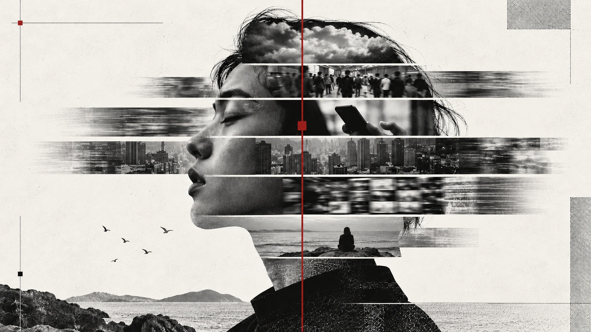
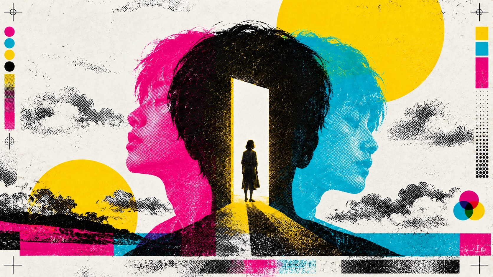
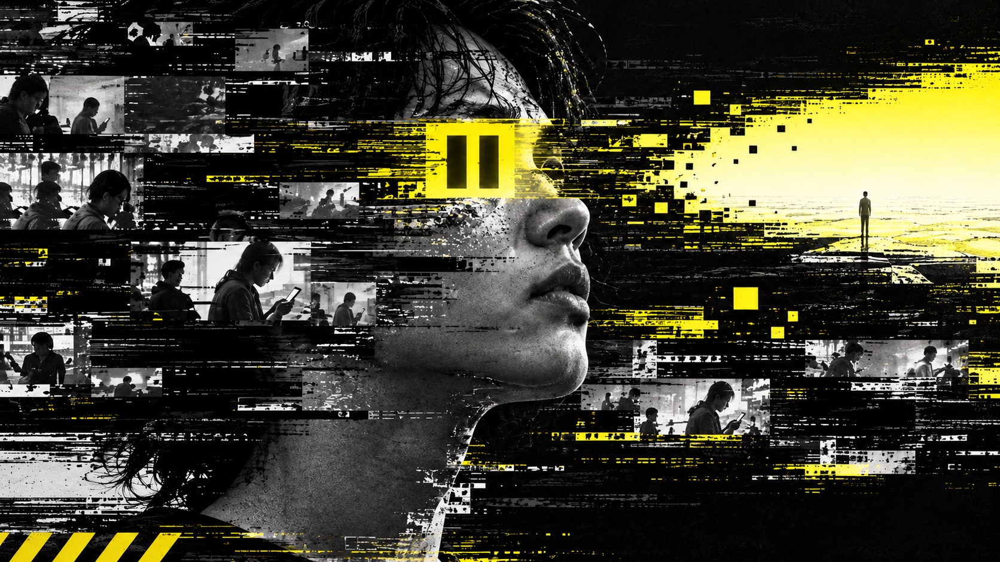
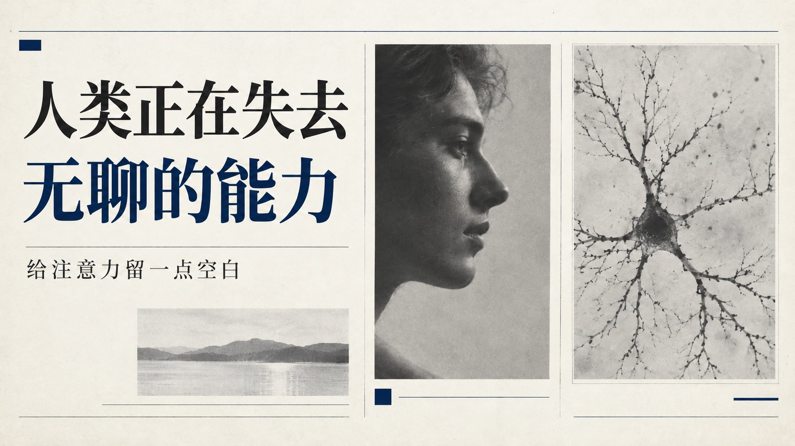
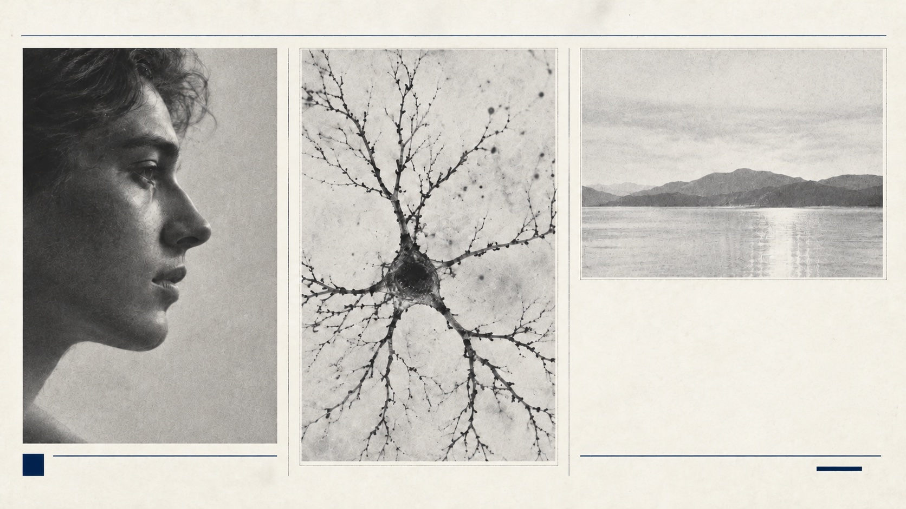
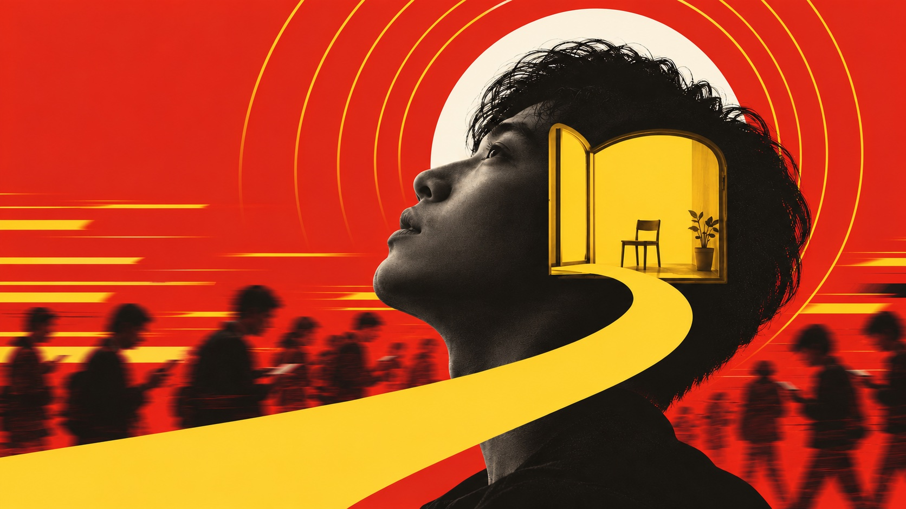
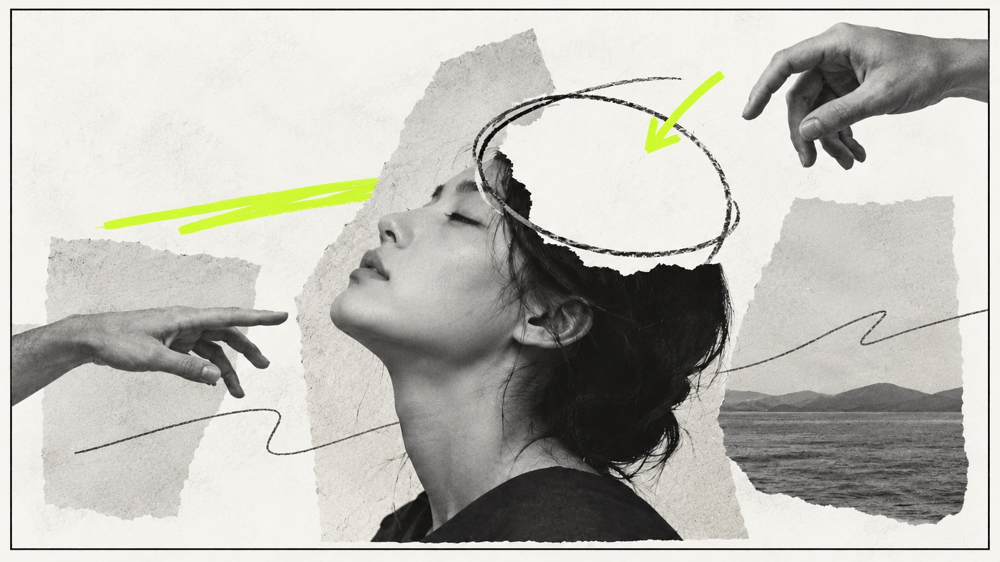

# 墨布自媒体插图

`inkment-media-illustrations` 是一套给 Codex 使用的自媒体视觉 Skill。你把标题、文章或发布平台交给它，它会先和你确定产物类型与视觉风格，再完成内容拆解、画面规划、原生生图、尺寸检查和本地归档。

它适合做三类内容：

- 封面：微信公众号、X、微博、小红书、视频号、B站、YouTube、知乎等平台的题图和封面。
- 文章插图：从完整文章里找出真正值得画出来的观点、转折和场景，并告诉你每张图应该插在哪里。
- 连续信息贴图：把文章重新组织成适合微信贴图号、小红书图片笔记等平台连续滑读的图片流。

当前版本：`V1.6.10`

[查看 11 种风格的有字与无字示例](#风格示例)

## 它解决什么问题

普通生图通常从一句提示词直接开画，结果经常是尺寸不对、系列不统一、中文太多、每张图各说各话，或者画完才发现不适合目标平台。

墨布自媒体插图把前期编辑、视觉策划和交付检查放进同一条流程里：

1. 先确认你要封面、文章插图还是连续贴图。
2. 再从 11 套墨非视觉风格中选择一套。
3. 根据文章和平台梳理文案、信息层级与视觉母题。
4. 在生成前给出完整简报，让你一次看清最终会做什么。
5. 确认后使用 Codex 原生生图能力制作图片。
6. 逐张检查比例、像素尺寸、中文、边距、对比和系列一致性。
7. 按项目名称归档到本地，方便后续继续修改或发布。

简单说，它不是只负责“画一张图”，而是负责把一篇内容变成一套可用、可改、可归档的视觉成品。

## 三种工作模式

### 1. 封面

适合已有标题，需要为某个平台制作单张或一组封面的场景。

Skill 会依次和你确认：

- 主标题
- 副标题
- 需要出现在画面上的补充文字
- 发布平台和画布规格
- 视觉母题
- 生成数量

如果要做多张，它会先说明这一组的递进关系，不会只是重复同一个版式换颜色。

微信公众号头图采用专门的双版流程。每个方案会独立制作：

- 横版：`900×383`，约 `2.35:1`
- 方版：`900×900`，`1:1`
- 组合预览图：`900×1283`，横版在上、方版在下

下面是一套实际拼接示例，上方是横版，下方是独立构图的方版：


[查看横版](docs/examples/wechat/landscape.jpg) · [查看方版](docs/examples/wechat/square.jpg) · [查看完整组合图](docs/examples/wechat/composite.jpg)

横版和方版会针对各自画幅重新构图，不是把其中一张直接裁成另一张。每个方案最终保留 3 个文件，组合图用于整体预览，两张原图可以分别发布。

### 2. 文章插图

适合长文、公众号文章、博客、专栏或需要多张配图的深度内容。

你可以一次发送完整文章，也可以分多段补充。Skill 会先阅读全文，再完成：

- 识别章节和主要转折
- 建议合理的插图数量
- 为每张图提取不同的核心亮点
- 说明图片在全文里的作用
- 给出精确插入位置
- 统一整组图片的视觉母题

默认尺寸为 `1600×900`，比例为 `16:9`。

插入位置会尽量写成这种形式：

> 放在〈为什么效率工具越来越多，人却越来越忙〉中“真正被切碎的是注意力”所在段落之后。

这样复制到编辑器里时，不需要再猜图片应该放在哪里。

默认情况下，文章插图以视觉表达为主，不会把整段正文塞进图片。你也可以选择让每张图显示一句经过确认的亮点文案。

### 3. 连续信息贴图

这里的“贴图”是由文章拆解而成的连续信息图片，不是聊天表情包，也不是单个透明贴纸。

它适合：

- 微信贴图号
- 小红书图片笔记
- 其他以多张图片连续阅读为主的内容平台

一组贴图通常由以下结构组成：

1. 首图：说清主题和阅读价值。
2. 正文卡：每张只讲一个核心信息单元。
3. 收束卡：总结、行动建议、开放问题或保留文章原有余韵。

Skill 会把整篇文章重新编辑成图片流，为每张卡片列出：

- 卡片角色
- 精确可见文案
- 信息层级
- 视觉对象
- 与前后图片的衔接关系

微信贴图号和小红书默认使用 `1242×1660`，比例为 `3:4`。同一组图片会锁定唯一尺寸，首图、正文卡和收束卡保持完全一致，避免发布时出现忽大忽小或裁切混乱。

## 11 套视觉风格

风格不是简单换一组颜色。每套风格都同时规定了色彩、字体气质、构图方式、图形语言、材质和节奏。

| 编号 | 风格 | 视觉气质 | 主要颜色 |
|---:|---|---|---|
| 01 | 墨布 · 黑白红 | 冷静、独立编辑、瑞士网格、档案拼贴 | 黑、白、灰、深红 |
| 02 | 夏香予文 · 蓝白金 | 人文、典雅、清澈、书刊感 | 白、海军蓝、哑光金 |
| 03 | 未来共生 · 黑白绿 | 未来科技、协作、系统感 | 黑、白、炭灰、荧光绿 |
| 04 | 活力飞扬 · 绿橙彩 | 明快、热情、运动、行动力 | 绿、橙、红、蓝 |
| 05 | 思潮碰撞 · 蓝黄撞色 | 观点鲜明、开放讨论、编辑张力 | 钴蓝、亮黄、黑、白 |
| 06 | 三原宣言 · 品青黄 | 实验印刷、先锋、套色错位 | 品红、青、黄、黑、白 |
| 07 | 程序错乱 · 赛博故障 | 警报、故障、紧迫、反乌托邦科技 | 黑、白、警报黄、少量红 |
| 08 | 墨非学刊 · 学术期刊 | 严谨、可信、安静、研究出版物 | 暖白、墨黑、深海军蓝 |
| 09 | 拾光手记 · 手帐风 | 温暖、个人、记忆、手作 | 米纸、珊瑚、鼠尾草绿、雾蓝 |
| 10 | 热力开场 · 金拱门 | 高能、直接、流行、快节奏海报 | 高饱和红、黄、白、深褐黑 |
| 11 | 边界批注 · 涂鸦风 | 独立文化、批判、机敏、手写痕迹 | 暖纸白、黑、荧光绿 |

如果你没有特别偏好，默认使用 `01 墨布 · 黑白红`。也可以选择“自定义风格”，直接提供参考图片、品牌色、关键词或你喜欢的视觉方向。

完整风格定义见 [visual-styles.md](inkment-media-illustrations/references/visual-styles.md)。

## 风格示例

下面用同一个主题「人类正在失去无聊的能力」展示 11 种风格。每种各一张有字封面和一张无字插图，方便比较色彩、构图、字体气质与材质。

每对图片共享主体和视觉母题。有字版用标题和画面共同表达，无字版调整画面布局，让图像本身讲清主题。

### 01 墨布 · 黑白红

| 有字版 | 无字版 · 纯视觉 |
|---|---|
|  |  |

### 02 夏香予文 · 蓝白金

| 有字版 | 无字版 · 纯视觉 |
|---|---|
|  |  |

### 03 未来共生 · 黑白绿

| 有字版 | 无字版 · 纯视觉 |
|---|---|
|  |  |

### 04 活力飞扬 · 绿橙彩

| 有字版 | 无字版 · 纯视觉 |
|---|---|
|  |  |

### 05 思潮碰撞 · 蓝黄撞色

| 有字版 | 无字版 · 纯视觉 |
|---|---|
|  |  |

### 06 三原宣言 · 品青黄

| 有字版 | 无字版 · 纯视觉 |
|---|---|
|  |  |

### 07 程序错乱 · 赛博故障

| 有字版 | 无字版 · 纯视觉 |
|---|---|
|  |  |

### 08 墨非学刊 · 学术期刊

| 有字版 | 无字版 · 纯视觉 |
|---|---|
|  |  |

### 09 拾光手记 · 手帐风

| 有字版 | 无字版 · 纯视觉 |
|---|---|
|  |  |

### 10 热力开场 · 金拱门

| 有字版 | 无字版 · 纯视觉 |
|---|---|
|  |  |

### 11 边界批注 · 涂鸦风

| 有字版 | 无字版 · 纯视觉 |
|---|---|
|  |  |

## 常用尺寸

| 用途 | 比例 | 目标尺寸 |
|---|---:|---:|
| X 主页顶部图 | 3:1 | 1500×500 |
| X 文章封面 | 5:2 | 1500×600 |
| X / 微博横版帖文 | 16:9 | 1600×900 |
| 微信公众号头图横版 | 2.35:1 | 900×383 |
| 微信公众号头图方版 | 1:1 | 900×900 |
| 小红书封面或贴图 | 3:4 | 1242×1660 |
| 抖音 / 视频号竖版封面 | 9:16 | 1080×1920 |
| B站 / YouTube 视频封面 | 16:9 | 1280×720 |
| 知乎 / 文章横版题图 | 16:9 | 1600×900 |
| 方形社交帖文 | 1:1 | 1080×1080 |
| 通用竖版海报 | 4:5 | 1080×1350 |

这些是内置的常用预设。你也可以直接指定平台、比例和像素尺寸。

更详细的安全区、拼接和文件命名规则见 [style-and-formats.md](inkment-media-illustrations/references/style-and-formats.md)。

## 安装

Codex Skill 是一个包含 `SKILL.md` 和相关参考资料的文件夹。Codex 支持把个人 Skill 放在 `~/.codex/skills`，也支持把团队共用的 Skill 放进项目的 `.codex/skills`。相关结构可参考 [OpenAI Skills 文档](https://developers.openai.com/plugins/build/skills)。

### 安装到个人 Codex

先克隆仓库：

```bash
git clone https://github.com/zkilxx/inkment-media-illustrations.git
```

再把 Skill 文件夹复制到个人 Skill 目录：

```bash
mkdir -p ~/.codex/skills
cp -R inkment-media-illustrations/inkment-media-illustrations ~/.codex/skills/
```

安装后的核心文件应该位于：

```text
~/.codex/skills/inkment-media-illustrations/SKILL.md
```

重新打开 Codex 会话后即可使用。

### 只在某个项目中使用

在目标项目根目录执行：

```bash
mkdir -p .codex/skills
cp -R /你的下载位置/inkment-media-illustrations/inkment-media-illustrations .codex/skills/
```

这样 Skill 会跟随当前项目使用，不影响其他项目。

## 怎么调用

最明确的方式是在对话中写出 Skill 名称：

```text
$inkment-media-illustrations
```

也可以直接描述需求。只要内容明显属于自媒体封面、文章插图或连续信息贴图，Codex 可以根据 Skill 的描述自动选择它。

### 封面示例

```text
使用 $inkment-media-illustrations，给《工具越来越多，人为什么反而更忙》做微信公众号封面。
```

```text
使用 $inkment-media-illustrations，做 3 张 X 横版帖文封面。主标题是《AI 不会替你思考》，风格用 01 墨布 · 黑白红。
```

### 文章插图示例

```text
使用 $inkment-media-illustrations，给下面这篇文章做 4 张插图。请先规划每张图的内容和插入位置，再让我确认生成。

（粘贴文章正文）
```

```text
使用 $inkment-media-illustrations，分析这篇文章需要几张插图。风格用 08 墨非学刊，不在画面里放标题。
```

### 连续贴图示例

```text
使用 $inkment-media-illustrations，把这篇文章拆成一组小红书图片笔记。默认 3:4，先给我信息结构，不要直接生图。

（粘贴文章正文）
```

```text
使用 $inkment-media-illustrations，把文章做成微信贴图号和小红书都能用的连续图片流。风格用 11 边界批注，控制在 8 张以内。
```

### 自定义风格示例

```text
使用 $inkment-media-illustrations 做一张 16:9 文章题图。我会提供一张参考图，请保留它的克制留白和纸张质感，但不要复制具体构图。
```

## 一次完整任务会怎样进行

假设你说：

> 给《人类正在失去无聊的能力》做一组小红书贴图。

接下来通常会经历这些步骤：

1. **选择交付类型**：封面、文章插图或贴图。
2. **选择风格**：从 01–11、自定义或默认风格中选择。
3. **补充内容**：提供文章标题与正文。
4. **确认平台**：例如小红书、微信贴图号或双平台。
5. **确定张数**：Skill 根据文章长度和信息密度给出建议。
6. **查看信息拆解**：逐张确认每张卡片讲什么、显示哪些字。
7. **选择视觉母题**：从 3 套不同方向中选择或组合。
8. **确认最终简报**：一次看清尺寸、张数、文案、文件名和归档位置。
9. **回复“确认生成”或“1”**：开始制作。
10. **检查与归档**：完成尺寸、文字和系列一致性检查后返回全部成品。

如果你一开始已经给出了标题、平台或风格，Skill 会保留这些信息，不会要求你重复回答。

## 视觉母题是什么

“风格”决定整套作品的设计语言，“视觉母题”决定这篇具体内容要用什么东西来表达。

比如同样使用 `01 墨布 · 黑白红`，一篇讨论注意力的文章可以有三种完全不同的母题：

- 直接编辑型：被多个窗口切开的侧脸与时间刻度。
- 概念象征型：一条不断分叉、最后消失的黑色路径。
- 意外诗性型：档案柜中唯一没有编号的空抽屉。

Skill 会根据文章和平台提供 3 个方向，并标出推荐项。你可以选一个、组合两个，或者提出自己的方案。

## 本地归档

生成前会先给出归档位置，确认后再创建目录。项目文件夹统一使用：

```text
YYYYMMDD｜主题
```

例如：

```text
图片归档/
└── 20261016｜人类正在失去无聊的能力/
    ├── 小红书贴图/
    │   ├── 人类正在失去无聊的能力-小红书-贴图-11-01.png
    │   ├── 人类正在失去无聊的能力-小红书-贴图-11-02.png
    │   └── ...
    └── 插图/
```

封面、文章插图和贴图使用各自的子目录与连续序号。已有同名文件会继续使用下一个序号，便于保留不同版本。

本地生成的 `图片归档/` 保存在你的电脑上。仓库包含 Skill 本体、规则文档、风格参考资产，以及 `docs/examples/` 中专供 README 展示的 22 张风格示例和公众号双版拼接示例。

## 项目结构

```text
inkment-media-illustrations/
├── README.md
├── .gitignore
├── docs/
│   └── examples/
│       ├── with-text/          # 11 张有字示例
│       ├── visual/             # 11 张同母题纯视觉示例
│       └── wechat/             # 公众号横版、方版与组合图
└── inkment-media-illustrations/
    ├── SKILL.md
    ├── agents/
    │   └── openai.yaml
    ├── assets/
    │   └── inkment-black-white-red-reference.jpeg
    └── references/
        ├── style-and-formats.md
        ├── visual-styles.md
        └── text-visual-variants.md
```

各文件的作用：

- `SKILL.md`：完整工作流程，决定先问什么、如何规划、何时生成和如何检查。
- `agents/openai.yaml`：Codex 界面中显示的名称、简介与默认提示。
- `references/visual-styles.md`：11 套视觉风格的详细设计语法。
- `references/style-and-formats.md`：平台尺寸、信息拆解、归档和命名规则。
- `references/text-visual-variants.md`：同主题有字/无字版本的构图调整与转换规则。
- `assets/inkment-black-white-red-reference.jpeg`：01 墨布 · 黑白红的视觉语言参考。
- `docs/examples/`：README 的风格展示图，按 01–11 与风格目录对应。

## 有字与无字互转

同一张图可以制作有字封面和无字插图两种版本。两版保持相同的主体、视觉母题、配色和材质，根据用途分别调整构图，像同一作品的两个版本。

有字转无字时，会调整主体大小、位置和图形关系，让画面本身表达主题；无字转有字时，会为确认的文案安排清晰的文字层级，并保留主要视觉。

可以直接这样说：

```text
把这张有字封面转成纯视觉插图，保留同一主体和母题，构图差异控制小一点。
```

```text
给这张无字图做一个有字版，主标题是《人类正在失去无聊的能力》，保留原来的风格。
```

也可以在新任务里直接要求同时交付两版，Skill 会先做一个基准版本，再据此制作对应版本。上面的 11 组风格示例展示了这种处理方式。

## 修改已有图片

同一轮对话里可以直接说要改什么，例如：

```text
第 3 张文字太密，拆成两张，其他图片保持不变。
```

```text
公众号方版的主体再靠上一点，横版不要改。
```

```text
保留这组贴图的文案和顺序，把风格从 01 改成 08。
```

Skill 会尽量保留没有被点名的内容和已经确认的决定。只有交付类型、文章、平台、风格或数量发生变化时，才会回到相应步骤重新确认。

## 使用建议

- 有完整文章时，直接贴全文，规划质量会明显高于只给一句标题。
- 希望画面出现文字时，提前写清楚哪些字必须保留原文。
- 一组图尽量只使用一套风格，让它像同一期刊或同一组栏目。
- 做贴图时可以先看信息拆解，再决定张数；内容密度比固定张数更重要。
- 有品牌色、旧封面或参考图时可以直接提供，Skill 会把它们纳入风格判断。
- 如果平台后台显示了新的比例或上传限制，直接把页面信息告诉 Skill，它会按实际规格制作。

## 版本

### V1.6.10

- 项目正式更名为 `inkment-media-illustrations`。
- 中文名称统一为“墨布自媒体插图”。
- 01 风格统一为“墨布 · 黑白红”。
- 支持封面、文章插图和连续信息贴图三种交付类型。
- 内置墨非 01–11 视觉系统。
- 微信公众号头图支持横版、方版和组合图三文件交付。
- 项目归档文件夹使用 `YYYYMMDD｜主题` 命名。

## 相关链接

- GitHub：<https://github.com/zkilxx/inkment-media-illustrations>
- OpenAI Skills 文档：<https://developers.openai.com/plugins/build/skills>
